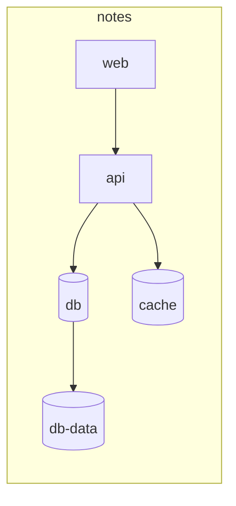

# infradiff

See what your infrastructure change actually does, as a diagram.

infradiff reads Docker Compose, Terraform, and Kubernetes into one graph,
renders it as Mermaid, JSON, or a self-contained HTML page, and shows exactly
what changed between two versions. It runs entirely offline and never prints
secret values.

```bash
infradiff generate examples/compose
```



The output above is trimmed for the README. The real renderer includes node
types, ports, and edge kinds.

## Install

Go 1.27 or newer:

```bash
go install github.com/nonomnonom/infradiff/cmd/infradiff@latest
```

Or build from a checkout:

```bash
git clone https://github.com/nonomnonom/infradiff
cd infradiff
make build
./bin/infradiff version
```

`version` prints `dev`; the project does not publish version numbers yet.

## Quick start

```bash
# Mermaid to stdout
infradiff generate examples/compose

# JSON to a file
infradiff generate examples/terraform -f json -o graph.json

# Self-contained HTML with pan and zoom
infradiff generate examples/kubernetes -f html -o diagram.html

# Compare two directories or files
infradiff diff old/ new/

# Compare the working tree against a commit
infradiff diff --git HEAD deploy/

# Regenerate on every change
infradiff generate deploy/ --watch -o diagram.html
```

The input can be a file or a directory. Compose is parsed per file; Terraform
and Kubernetes are parsed per directory because their files reference each
other. Saved Terraform plan JSON is a single-file input.

## What is parsed

| Input | Files | Graph content |
| --- | --- | --- |
| Docker Compose | `compose.yaml`, `docker-compose.yml`, or YAML with a `services` mapping | Services, databases, caches, queues, volumes, networks, published ports, `depends_on`, and environment names. |
| Terraform | `.tf` files in one directory | Resources such as instances, databases, buckets, load balancers, networks, and security groups; references become edges. |
| Terraform plan | Saved plan JSON | Planned resources, their actions, and references. |
| Kubernetes | Multi-document YAML or JSON in one directory | Deployments, StatefulSets, DaemonSets, Jobs, CronJobs, Services, Ingresses, ConfigMaps, Secrets, PVCs, and namespaces; selectors, ingress backends, and config/secret references become edges. |

Node types are inferred from the image, resource type, or Kubernetes kind.
Unknown resources are kept as `other` instead of being dropped.

## Output formats

| Format | Use |
| --- | --- |
| `mermaid` (default) | Diffs in pull requests, notes, and documentation. |
| `json` | Machine-readable graphs and diffs. The shape is documented in [docs/json-schema.md](docs/json-schema.md) and validated by the test suite. |
| `html` | A single self-contained page with the Mermaid runtime, pan, zoom, and a legend. Works offline. |

Output is deterministic: the same inputs produce byte-identical bytes on every
platform. Nodes and edges have stable IDs that do not contain absolute paths,
so moving a checkout does not make everything look changed.

## Diff

`infradiff diff` marks nodes and edges as `added`, `removed`, `changed`, or
`unchanged`, then renders the result with the same formats. Attributes that
count as a change are name, type, group, and metadata; moving a node to another
line is not a change. A pair of nodes keeps one edge, with the most specific
kind (`routes_to` > `reference` > `depends_on` > `port` > `volume` >
`network`).

`--fail-on-change` exits with status 1 when anything changed, which makes it
usable as a CI gate. The rendered output is still written first.

## Commands

```
infradiff generate <path> [-f mermaid|json|html] [-o file] [--watch]
infradiff diff <old> <new> [-f mermaid|json|html] [-o file] [--fail-on-change]
infradiff diff --git <ref> [path] [-f ...] [-o file] [--fail-on-change]
infradiff mcp [workspace]
infradiff version
```

## Integrations

- **MCP server**: `infradiff mcp` exposes `generate_diagram`,
  `diff_infrastructure`, and `explain_graph` over stdio. See
  [docs/mcp.md](docs/mcp.md) for Claude Desktop, Claude Code, and Cursor setup.
- **GitHub Action**: builds the CLI and adds a Mermaid diagram or diff to the
  job summary, with optional pull request comments. See
  [docs/github-action.md](docs/github-action.md).
- **VS Code extension**: preview infrastructure in a webview and diff against a
  git revision. See [vscode/README.md](vscode/README.md).
- **Agent skill**: [SKILL.md](SKILL.md) describes when and how coding agents
  should use infradiff.

## Security

- No network access at runtime. The HTML page embeds Mermaid instead of loading
  a CDN, and no telemetry is collected.
- Secret values are redacted before rendering when a metadata key contains
  `password`, `secret`, `token`, `key`, or `credential`. Only environment and
  secret names are kept.
- The MCP server rejects paths outside its workspace, including paths that
  escape through `..` or symbolic links.
- The CLI only reads the paths it is given. The VS Code extension runs the CLI
  without a shell.

## Development

```bash
make test          # go test ./...
make fmt           # gofmt check
make vet           # go vet ./...
make lint          # golangci-lint, installed into .bin on first use
make cross         # linux, macOS, and Windows binaries for amd64 and arm64
```

The Go code has no runtime dependencies beyond the parser and CLI libraries in
`go.mod`. Golden files live in `testdata/`; regenerate them only when the
intended output changes.

VS Code extension:

```bash
cd vscode
npm ci
npm run typecheck
npm run build
npm run package
```

GitHub Action: the script in `scripts/github-action.sh` can be exercised
locally with the `INPUT_*`, `GITHUB_ACTION_PATH`, and `GITHUB_WORKSPACE`
environment variables described in [docs/github-action.md](docs/github-action.md).

## License

MIT. See [LICENSE](LICENSE).
